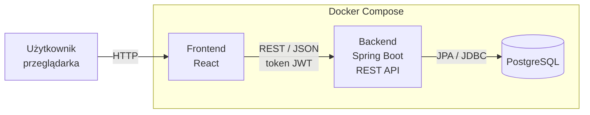
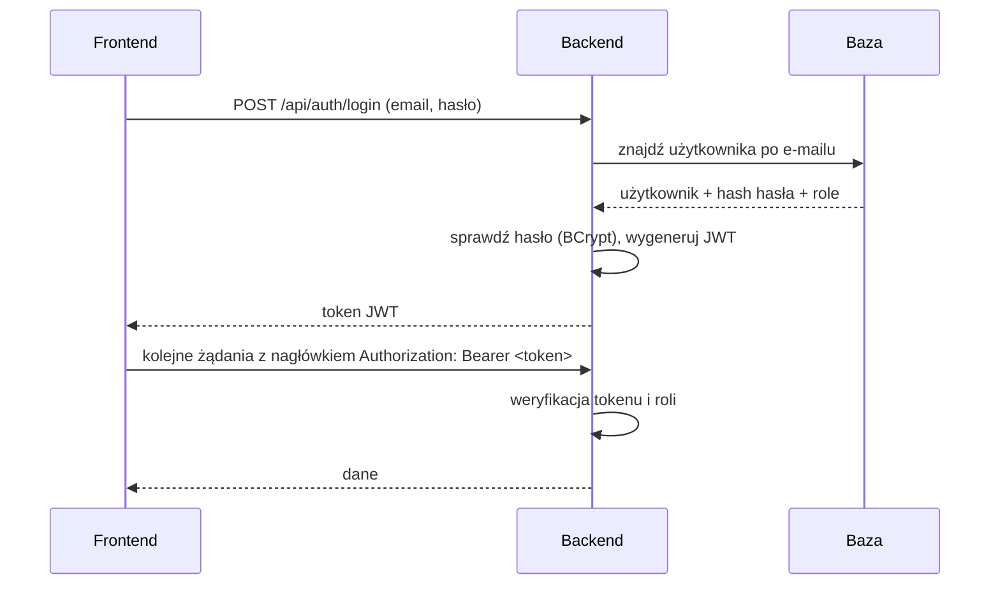
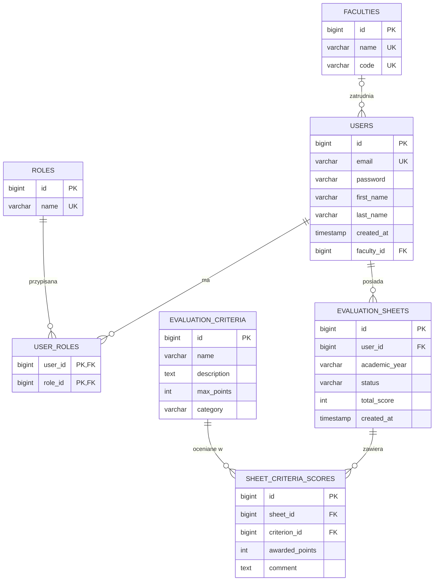

# Architektura systemu

## 1. Ogólny opis

System jest aplikacją internetową w architekturze **klient–serwer** z podziałem na trzy warstwy:

1. **Frontend (React)**: interfejs użytkownika uruchamiany w przeglądarce. Komunikuje się z backendem wyłącznie przez REST API (JSON).
2. **Backend (Spring Boot)**: logika biznesowa, uwierzytelnianie i autoryzacja, liczenie punktów, generowanie arkuszy i raportów.
3. **Baza danych (PostgreSQL)**: przechowuje użytkowników, definicje systemów oceny, osiągnięcia i oceny. Schemat zarządzany jest migracjami Flyway.

Każda warstwa działa w osobnym kontenerze Dockera, a całość uruchamia Docker Compose.

## 2. Uwierzytelnianie

Logowanie odbywa się tokenem **JWT** (bez sesji po stronie serwera):

## 3. Struktura backendu

Backend ma klasyczny podział warstwowy:

| Pakiet | Odpowiedzialność |
|--------|------------------|
| `controller` | Endpointy REST: przyjmują żądania i zwracają DTO |
| `service` | Logika biznesowa (liczenie punktów, przebieg weryfikacji) |
| `repository` | Dostęp do bazy (Spring Data JPA) |
| `entity` | Encje JPA odpowiadające tabelom |
| `dto` | Obiekty przesyłane przez API (bez danych wrażliwych) |
| `security` | Konfiguracja Spring Security, obsługa JWT |

Przepływ żądania: **Controller → Service → Repository → Baza**.

## 4. Model danych (ERD)

Stan bazy na koniec sprintu 1 (migracje V1–V4):

### Planowane zmiany modelu

- **Sprint 2:** relacja przełożony → podwładny (`users.supervisor_id`), stanowisko pracownika.
- **Sprint 3:** hierarchia obszar → kategoria → osiągnięcie zamiast płaskiej tabeli `evaluation_criteria`, okresy oceny i wersjonowanie systemów oceny.
- **Sprint 4:** tabela osiągnięć pracownika i załączników.

## 5. Kluczowe decyzje techniczne

| Decyzja | Uzasadnienie |
|---------|--------------|
| REST API + osobny frontend | Niezależny rozwój backendu i frontendu przez dwie części zespołu |
| JWT zamiast sesji | Prosta współpraca z frontendem React, backend nie przechowuje stanu |
| Flyway | Wersjonowane zmiany bazy, ten sam schemat u każdego członka zespołu |
| Docker Compose | Jednakowe środowisko u wszystkich, uruchomienie jednym poleceniem |
| PostgreSQL | Darmowa, stabilna relacyjna baza, dobrze wspierana przez Spring |
